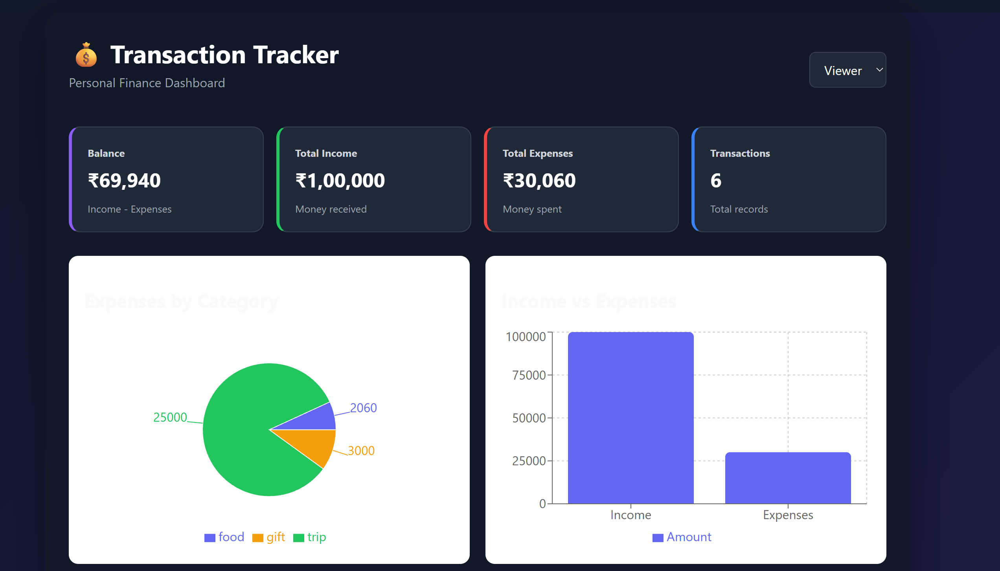
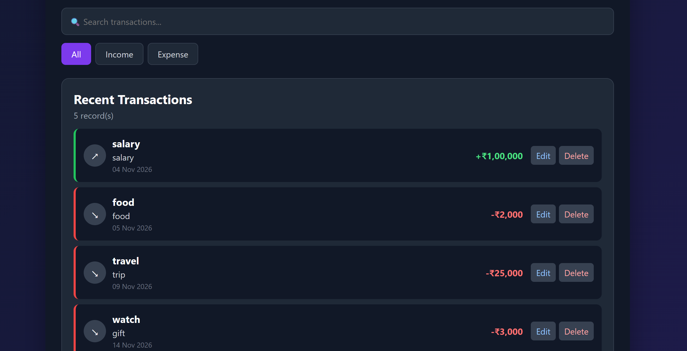
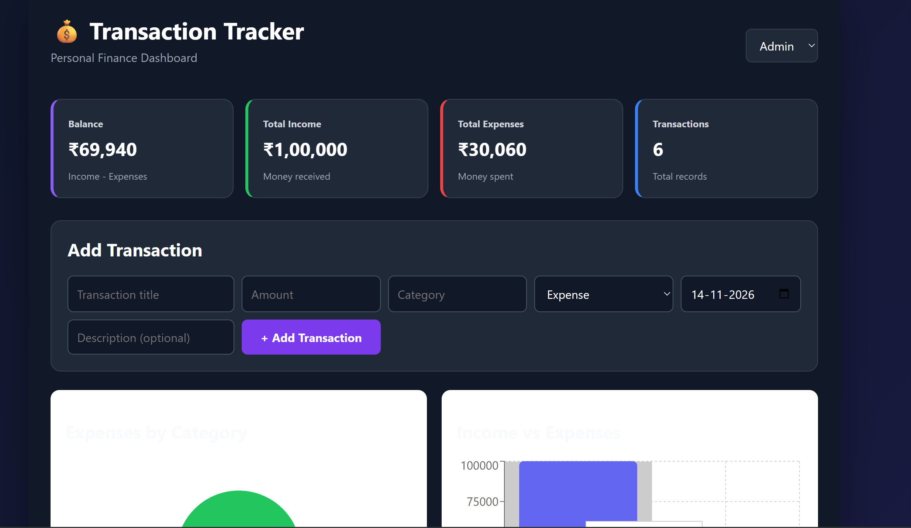

# 💰 Transaction Tracker

A full-stack personal finance management application built using React, FastAPI, and SQLite. It allows users to manage income and expenses, track their balance, and visualize financial activity through interactive charts.

## 🚀 Overview

Transaction Tracker is a web application designed to simplify personal financial management. Users can add, view, edit, delete, search, and filter transactions.

The React frontend communicates with a FastAPI backend through REST APIs, while SQLite stores transaction records persistently.
## 📸 Application Screenshots

### Dashboard – Viewer Mode


### Transaction History


### Admin Mode – Add Transaction


## ✨ Features

- Add income and expense transactions
- Edit existing transactions
- Delete transactions
- View transaction history
- Search transactions by title
- Filter transactions by All, Income, and Expense
- Track total balance, income, and expenses
- Visualize financial data using interactive charts
- Store transaction data persistently using SQLite
- Admin and Viewer interface modes
- Handle empty states and API errors

## 🛠️ Tech Stack

### Frontend
- React
- JavaScript
- Vite
- Recharts
- CSS

### Backend
- Python
- FastAPI
- SQLAlchemy
- Pydantic
- Uvicorn

### Database
- SQLite

### Tools
- Visual Studio Code
- Git and GitHub
- REST API

## 🏗️ Project Architecture

```text
React Frontend
      |
      | HTTP Requests (REST API)
      |
FastAPI Backend
      |
      | SQLAlchemy ORM
      |
SQLite Database
```

The frontend sends requests to the FastAPI backend. The backend processes the requests and performs database operations using SQLAlchemy. The updated data is then returned to the frontend.

## 📂 Project Structure

```text
transaction-tracker/
│
├── backend/
│   ├── main.py
│   ├── database.py
│   ├── models.py
│   ├── schemas.py
│   └── requirements.txt
│
├── src/
│   ├── App.jsx
│   └── ...
│
├── index.html
├── package.json
├── package-lock.json
├── README.md
└── .gitignore
```

## ⚙️ Installation and Setup

### 1. Clone the repository

```bash
git clone https://github.com/reshmagoud124-boop/transaction-tracker.git
```

### 2. Navigate to the project directory

```bash
cd transaction-tracker
```

### 3. Install frontend dependencies

```bash
npm install
```

### 4. Set up the backend

Create a Python virtual environment:

```bash
python -m venv backend/venv
```

Activate it on Windows PowerShell:

```powershell
.\backend\venv\Scripts\Activate.ps1
```

Install backend dependencies:

```bash
pip install -r backend/requirements.txt
```

### 5. Start the backend server

From the project root, run:

```bash
python -m uvicorn backend.main:app --reload
```

Backend URL:

```text
http://127.0.0.1:8000
```

API documentation:

```text
http://127.0.0.1:8000/docs
```

### 6. Start the frontend

Open a second terminal in the project directory and run:

```bash
npm run dev
```

Open the application:

```text
http://localhost:5173
```

## 🔗 API Endpoints

| Method | Endpoint | Description |
|---|---|---|
| GET | `/transactions` | Retrieve all transactions |
| POST | `/transactions` | Add a transaction |
| PUT | `/transactions/{id}` | Update a transaction |
| DELETE | `/transactions/{id}` | Delete a transaction |
| GET | `/health` | Check backend status |

## 💾 Database

The application uses SQLite to store transaction information, including:

- Transaction ID
- Title
- Amount
- Category
- Type (Income or Expense)
- Date
- Description

The database file is created automatically when the backend starts.

## 🔮 Future Improvements

- User authentication and authorization
- Secure Admin and Viewer access
- Monthly and yearly financial reports
- Budget tracking and spending alerts
- Cloud database integration

## 👩‍💻 Developer

**G. Reshma**

GitHub: https://github.com/reshmagoud124-boop

---

⭐ If you find this project useful, consider giving the repository a star!
